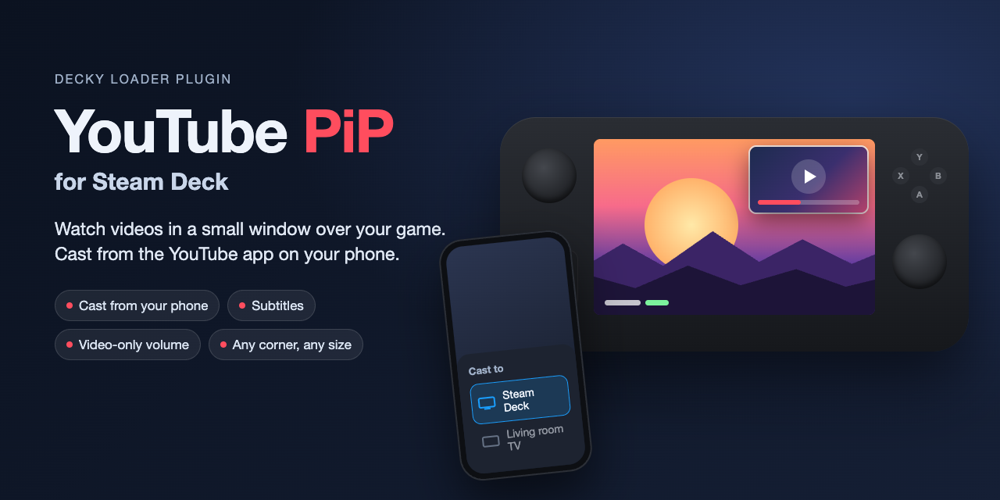
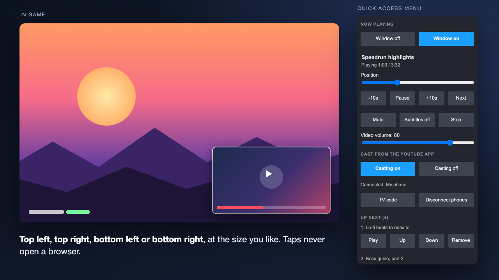
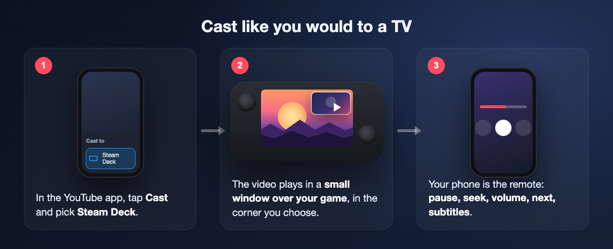

# YouTube PiP for Steam Deck



A [Decky Loader](https://github.com/SteamDeckHomebrew/decky-loader) plugin that plays YouTube in a small
picture-in-picture window **over your game** in Gaming Mode. Pick videos from your phone: cast from the YouTube app
like you would to a TV, or scan a QR code and paste a link.

> **Beta.** Built and tested against YouTube's real servers and a real YouTube player in a browser, but only lightly
> tested on a Steam Deck so far. Feedback and bug reports are welcome (see [Reporting a problem](#reporting-a-problem)).

## Features

- **Floating window over games**: small 16:9 window in any corner, adjustable size and margin.
- **Cast from the YouTube app**: the Deck shows up as **Steam Deck** in the app's cast list. Your phone is the remote:
  play, pause, seek, volume, next, queue and subtitles. No account needed on the Deck.
- **TV code** for when the Deck doesn't appear in the cast list (Settings > Watch on TV > Enter TV code).
- **Phone link**: scan a QR code, paste any YouTube link, control playback from the phone's browser.
- **Controls in the Quick Access menu**: play/pause, seek, next, mute, **subtitles on/off**, and a
  **video-only volume slider** (game sound is not touched).
- **Queue** with play now / move / remove, repeat off / all / one.
- **Nothing in the window can open a browser**: taps never reach YouTube's links, and YouTube's overlays are hidden.
- **Hide while menus are open** (optional): the window steps aside while the Steam or Quick Access menu is open;
  the sound keeps playing.
- **Keeps working after sleep**: reconnects to YouTube right after the Deck wakes up.
- Casting **on/off** switch and **Disconnect phones** (unpairs every phone).



## Install

You need [Decky Loader](https://github.com/SteamDeckHomebrew/decky-loader) installed.

**From URL (easiest)**
1. Decky settings (gear icon in the Decky tab) > enable **Developer mode**.
2. Decky settings > **Developer** > **Install Plugin from URL**, paste:
   `https://github.com/YOUR_GITHUB_NAME/youtube-pip/releases/download/v0.6.0/youtube-pip-v0.6.0.zip`

**From a ZIP file**: download `youtube-pip-v0.6.0.zip` from [Releases](../../releases), then
Decky settings > Developer > **Install Plugin from ZIP File**.

**From Konsole** (Desktop Mode):
```
unzip youtube-pip-v0.6.0.zip
sudo cp -r youtube-pip ~/homebrew/plugins/ && sudo systemctl restart plugin_loader
```

## Use



1. Open the Quick Access menu (the `...` button) > **YouTube PiP**.
2. On your phone (same Wi-Fi as the Deck), open the YouTube app, tap the **cast** icon and pick **Steam Deck**.
   Not in the list? Press **TV code** in the panel and enter it in the app: Settings > Watch on TV > Enter TV code.
3. Pick a video on the phone. It plays in the window on the Deck; the phone is the remote.
4. Window corner, size, the phone link (QR code), options and Check setup are under **More**.

## How it works

- The window is a native Steam browser view drawn on Steam's notification layer, so it shows over games
  (the approach of [decky-pip](https://github.com/rossimo/decky-pip)).
- It loads a small local page with YouTube's official embedded player; the plugin drives it (play, seek, volume,
  subtitles). An invisible layer on top stops taps from reaching YouTube's links.
- Casting: the plugin joins YouTube's cast service as a "screen", the same protocol smart TVs use, and answers the
  app's cast search on your network (SSDP/DIAL). The phone tells the screen which video to play; the plugin plays it in
  its own player. YouTube's TV web app is not used.
- Backend: Python standard library only, network through the system `curl`.

## Limits

- **Videos whose owner turned off embedding** can't play (rare; the plugin skips them). Ads play as normal.
- **Not signed in** on the Deck: no account features (history, Premium) in the window.
- **Same Wi-Fi** for casting and the phone link. Routers with "client isolation" (common on guest networks) block
  discovery; use the TV code then.
- **Privacy**: while casting is on, anyone on your Wi-Fi can find the Deck in their cast list, and a paired phone
  can control playback. Turn casting off or press Disconnect phones in the panel. The phone link is plain HTTP on your
  network, protected by a secret link (**New link** in More > Phone makes a new one).
- Uses **undocumented Steam internals** for the overlay; a Steam client update can break it. More > Help >
  **Check setup** shows which part.
- Not affiliated with, endorsed by or sponsored by YouTube or Google. YouTube is a trademark of Google LLC.

## Reporting a problem

Open an issue with:
- a photo of **More > Help > Check setup**,
- the log: `tail -n 50 ~/homebrew/logs/"YouTube PiP"/*.log` (Desktop Mode, Konsole),
- your SteamOS and Decky versions, and what you did.

## Build from source

The release ZIP ships a pre-built `dist/index.js`, so users don't build anything.
To build: `pnpm install && pnpm run build` (official Decky toolchain, `@decky/rollup`).
Files: `main.py` (backend: local server, player commands, cast discovery), `ytpip_lounge.py` (YouTube cast
receiver), `assets/player.html` (the window's page), `assets/remote.html` (phone page), `src/` (Quick Access panel).

## Credits and license

BSD 3-Clause, see [LICENSE](LICENSE). Credits in [NOTICE](NOTICE): decky-pip by Ross Squires (overlay approach),
Project Nayuki's QR Code generator (structure of the QR encoder). The cast receiver is a new implementation; the
protocol is documented by open-source projects such as yt-cast-receiver and plaincast.
